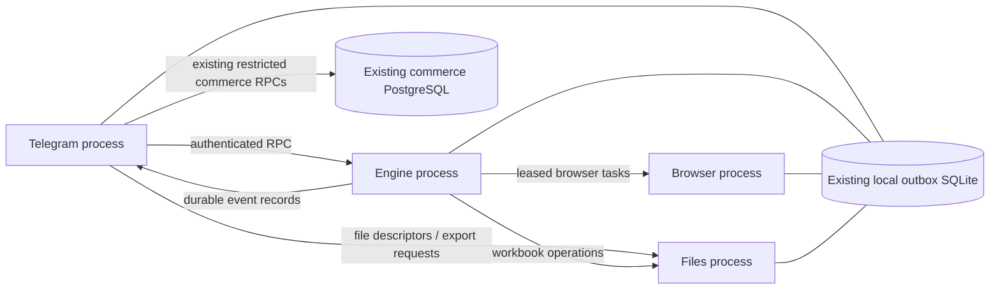

# Four independently managed processes

| Process | Entry point | Mutable state owned |
|---|---|---|
| Telegram | `python -m services telegram --root ROOT` | Bot intake, UI state, existing commerce delivery/settlement outbox and notifications |
| Files | `python -m services files --root ROOT` | Workbook parsing, result generation, source updates and preview XLSX writes |
| Engine | `python -m services engine --root ROOT` | Existing queue JSON, checkpoints, WAL, leases, API workers and continuous scheduler |
| Browser | `python -m services browser --root ROOT` | Browser tasks, Playwright contexts, proxies and owned Chromium children |

IPC reuses the existing SQLite file with separate namespaced tables and standard-library authenticated loopback HTTP. There is no additional database server or message broker. Existing PERSIST journal mode and FULL synchronization are retained. SQLite transactions coordinate shared message tables; each business-state domain has one application owner.

Service mode is explicit. The legacy entry point remains available for controlled rollback. Engine workspace locking excludes a second queue owner. Both old and new Telegram runners acquire a token-scoped kernel lock. A cutover must stop the old monolith before starting the new workbook owners; locks cannot retroactively protect an older, already-running unmodified binary.

Simple Telegram rendering reads local observations. Unknown/stale engine state remains visibly unknown; observations never authorize execution. Mutations go through explicit engine commands that recheck current state. Customer dispatch additionally checks the authoritative funded/consented order gate, including direct dashboard paths in service mode.
